# Awesome Interactive Live Mobile App Testing 📱⚡

  

  
  
  
  
  
  

---

## 🚀 Overview & Ecosystem Summary

Welcome to the definitive, curated index of **Interactive Live Mobile App Testing Platforms**, **Real Device Clouds**, **Remote Mobile Device Farms**, and **Low-Latency Screen Mirroring / Emulation Tools**.

Mobile application quality assurance (QA), SDETs, and mobile DevOps engineers require instant, high-fidelity interactive remote control over real physical iOS (`.ipa`) and Android (`.apk`, `.aab`) smartphones and tablets directly from their web browsers. Whether you are conducting exploratory manual QA, verifying biometrics and camera injection, debugging geolocation-specific user flows, or executing continuous integration (CI/CD) automated testing, this directory benchmarks the entire landscape across both **commercial enterprise SaaS solutions** and **self-hosted open-source architectures**.

### 🌟 Key Capabilities Covered
- 📲 **Real Physical Device Clouds**: Remote touch gestures (swipe, pinch, multi-touch), ADB tunneling, and real-time audio/video streaming.
- 🌐 **In-Browser Interactive Emulators / Simulators**: Lightweight zero-install app streaming (WebRTC / H.264 / noVNC) for sales demos, customer support, and QA.
- 🧪 **Hardware & Network Simulation**: GPS location spoofing, network throttling (3G/4G/5G/offline), biometric authentication mocking (FaceID/Fingerprint), and device rotation.
- 🏗️ **Self-Hosted On-Premises Device Farms**: USB rack infrastructures, smart hub power cycling, Android AIC (Android-in-Cloud), and WebDriverAgent orchestration.

---

## 📑 Table of Contents
- [📊 Sector Overview & Market Dynamics](#-sector-overview--market-dynamics)
- [☁️ SaaS & Hosted Real Device Clouds](#️-saas--hosted-real-device-clouds)
- [🛠️ Open-Source GitHub Projects](#️-open-source-github-projects)
- [📈 Star History](#-star-history)
- [🤝 How to Contribute](#-how-to-contribute)
- [💖 Support & Sponsor](#-support--sponsor)
- [📜 Disclaimer](#-disclaimer)

---

## 📊 Sector Overview & Market Dynamics

The global **Mobile Application Testing and Cloud Device Farm market** is valued at approximately **$7.7 Billion to $8.6 Billion** and is projected to surge past **$25 Billion to $34 Billion by the mid-2030s**, exhibiting a robust Compound Annual Growth Rate (CAGR) of **13%–16%**. 

This sector is characterized by **moderate market fragmentation transitioning toward consolidation among top-tier hyper-scale platforms**, counterbalanced by a flourishing **open-source self-hosted ecosystem**:
- **Why it is NOT purely winner-take-all**: The physical realities of hardware maintenance (battery swelling, OEM firmware nuances across Samsung/Xiaomi/Oppo, carrier network differences, and strict data-sovereignty/financial compliance regulations) make a single-vendor monopoly impractical. Enterprises frequently hybridize by pairing enterprise real-device clouds for broad matrix coverage with self-hosted private on-premise device farms for proprietary IP protection and zero-latency internal developer loops.
- **Key Market Drivers**: Severe device & OS fragmentation (thousands of Android SKUs, variable aspect ratios, foldable screens, and iOS version adoption curves), continuous DevOps integration, and rigorous mobile app store approval mandates.

---

## ☁️ SaaS & Hosted Real Device Clouds

The table below outlines the premier commercial platforms for interactive live mobile app testing. In compliance with repository requirements, companies are ranked in **descending order by company scale (market valuation / revenue)**. Specific starting prices and clear free tier / trial parameters are provided.

| 🏢 Platform | 💰 Company Scale (Valuation / Revenue) | 🏷️ Pricing (Starting Tier) | 🎁 Free Tier Limits / Free Trial Policy | 🔍 Key Focus & Interactive Capabilities |
| :--- | :--- | :--- | :--- | :--- |
| **[AWS Device Farm](https://aws.amazon.com/device-farm/)** | **$2+ Trillion** (Market Cap) / **$100B+ ARR** (AWS) | **$0.17 / device minute** (Pay-as-you-go) or **$250 / month** per unmetered device slot | **1,000 free device minutes** one-time trial on pay-as-you-go; no expiration until consumed | Interactive browser-based remote access and automated testing across real Android and iOS devices hosted in AWS data centers. |
| **[Sauce Labs](https://saucelabs.com)** | **~$1.0B Valuation** / **~$150M+ ARR** | **$39 / month** (billed annually) or **$49 / month** (billed monthly) for Live Testing; **$199 / month** for Real Device Cloud | **28-day free trial** with **60 total test minutes** across real/virtual devices and 3 parallel virtual machines (no credit card required) | Enterprise mobile & cross-browser testing cloud with live manual debugging, biometric simulation, network throttling, and Sauce Connect tunneling. |
| **[BrowserStack App Live](https://www.browserstack.com/app-live)** | **$4.0B Valuation** (Series B) / **~$230M ARR** | **$29 / user / month** (billed annually) or **$39 / month** (Desktop & Mobile); **$19 / user / month** (Freelancer edition) | **Free trial with limited interactive minutes** (typically **1–5 free interactive device minutes** per session on select public devices; sign-up trial credits) | Gold-standard real device cloud granting instant interactive access to 3,000+ real iOS and Android devices directly in the browser with dev tools & ADB logs. |
| **[Perforce (Perfecto)](https://www.perfecto.io)** | **~$2.5B–$3.0B Enterprise Value** / **~$500M+ Revenue** (Perforce) | **$300 / month** (base enterprise entry tier for live manual & automated cloud testing) | **14-day free trial** in public cloud environment (hands-on evaluation of real device sessions and scriptless automation) | Enterprise-grade digital testing cloud supporting manual interactive testing, location spoofing, biometric authentication, and audio/voice injection on real devices. |
| **[SmartBear (BitBar)](https://smartbear.com/product/bitbar/)** | **~$1.5B–$2.0B Enterprise Value** / **~$300M+ Revenue** (SmartBear) | **$39 / user / month** (billed annually) or **$47 / user / month** for BitBar Live Testing; **$177 / month** for Unlimited Automation | **14-day free trial** (instant browser access to real Android & iOS physical devices with automated and manual testing; no credit card required) | Flexible cloud testing lab providing instant interactive browser access to physical smartphones and tablets for manual exploratory QA and automated grids. |
| **[HeadSpin](https://www.headspin.io)** | **~$1.1B Valuation** (Unicorn peak) / **~$40M–$60M ARR** | **$39 / month** (introductory localized modules); comprehensive real-device carrier access starts via tailored tiers around **$199 / month** | **No permanent free tier**; **Free trial / guided PoC on request** (custom proof-of-concept configured via solutions engineering team) | Global real-device digital experience platform offering remote live interactive testing across real SIM carrier networks with deep AI audio/video telemetry. |
| **[Kobiton](https://kobiton.com)** | **~$40M+ Funding** / **~$20M–$27M ARR** | **$83 / month** (Startup plan, billed annually) providing 500 device minutes/month, manual testing & public cloud access | **14-day free trial** with access to public real-device cloud and complimentary starter minutes | Mobile-first testing platform delivering ultra-responsive live manual gesture control, camera injection, local USB debugging, and automated session replay. |
| **[TestGrid](https://testgrid.io)** | **Seed / Pre-Series A** / **~$5M ARR** | **$199 / month** (CoTester Starter Package for real device cloud & AI test authoring) | **Freemium tier with 200 free testing minutes** / guided trial proof-of-concept on request | AI-powered test execution cloud providing live interactive manual testing on physical iOS and Android smartphones alongside scriptless AI test authoring. |
| **[Appetize.io](https://appetize.io)** | **Bootstrapped / Seed** / **~$1.2M ARR** | **$89 / month** (Starter plan, or **$59 / month** billed annually) with 500 streaming minutes/month and 3 concurrent devices | **Permanent Free Tier**: **30 free minutes / month**, **2 active devices**, and a **3-minute session limit** per run (no credit card required) | Lightweight, browser-based iOS simulators and Android emulators for zero-install app streaming, live demos, customer support diagnostics, and rapid QA. |
| **[Genymotion SaaS](https://www.genymotion.com/cloud/)** | **Acquired by Shadow** / **$10M+ Total Funding** | **$0.05 / minute** (Pay-as-you-go) or **$179 / virtual device / month** (Unlimited SaaS annual subscription) | **60 free minutes** individual free trial (2 concurrent virtual devices); **1,000 free minutes** enterprise trial on corporate verification | Scalable cloud-hosted Android virtual devices (AIC) streamed through WebRTC directly into web browsers with customizable CPU/RAM/OS configurations. |

---

## 🛠️ Open-Source GitHub Projects

For engineering organizations looking to build private on-premise device farms, self-hosted testing labs, or custom low-latency mirroring pipelines, the open-source ecosystem provides battle-tested building blocks.

The repositories below are ranked in **descending order by GitHub Star count**. Each star badge links directly to that repository's stargazers page.

| 📦 Project | ⭐ GitHub Stars | 🗂️ Focus Area | 📝 Description & Architectural Utility |
| :--- | :--- | :--- | :--- |
| **[scrcpy](https://github.com/Genymobile/scrcpy)** |  | Screen Mirroring & Control | The industry standard for ultra-low-latency (30~70ms), high-performance display and touch control of Android devices over USB or TCP/IP without root. |
| **[Selenium](https://github.com/SeleniumHQ/selenium)** |  | Distributed Testing Grid | The foundational browser and test automation framework; Selenium Grid 4 routes live interactive VNC and WebDriver sessions to mobile Appium nodes. |
| **[QtScrcpy](https://github.com/barry-ran/QtScrcpy)** |  | Desktop GUI Mirroring | Cross-platform C++/Qt application providing real-time Android screen mirroring, multi-device batch control, keymapping, and remote wireless management. |
| **[MobSF](https://github.com/MobSF/Mobile-Security-Framework-MobSF)** |  | Security & Dynamic QA | Automated mobile application pen-testing and dynamic analysis framework featuring an instrumented Android/iOS interactive runtime environment. |
| **[Maestro](https://github.com/mobile-dev-inc/maestro)** |  | UI Automation & Studio | Modern mobile UI testing framework built for speed, featuring **Maestro Studio** for interactive in-browser live element inspection and flow authoring. |
| **[Docker-Android](https://github.com/budtmo/docker-android)** |  | Containerized Emulators | Complete Android-in-Docker solution equipped with noVNC web streaming, ADB access, video recording, and Appium support for scalable CI/CD testing. |
| **[noVNC](https://github.com/novnc/noVNC)** |  | Web VNC Client | HTML5 VNC client library enabling zero-install remote desktop, emulator, and mobile device screen streaming in any modern web browser. |
| **[OpenSTF](https://github.com/openstf/stf)** |  | Original Device Farm | The pioneering Smartphone Test Farm web platform that defined browser-based remote Android device control, remote shell, and logcat monitoring. |
| **[Flipper](https://github.com/facebook/flipper)** |  | Interactive Debugging | Meta's desktop debugging platform for iOS and Android featuring live UI hierarchy visualization, network traffic inspection, and SQLite browsing. |
| **[Waydroid](https://github.com/waydroid/waydroid)** |  | Containerized Android OS | Container-based system using Linux namespaces and LXC to boot full Android images on standard GNU/Linux hosts with near-native hardware speed. |
| **[libimobiledevice](https://github.com/libimobiledevice/libimobiledevice)** |  | iOS Protocol Library | Cross-platform C software library communicating natively with iOS devices over USB/Wi-Fi without requiring Apple proprietary software. |
| **[Gnirehtet](https://github.com/Genymobile/gnirehtet)** |  | Reverse Tethering | Provides reverse tethering over ADB for Android devices, routing device network traffic through the host machine without root permissions. |
| **[ReDroid (Remote-Android)](https://github.com/remote-android/redroid-doc)** |  | Cloud Android (AIC) | GPU-accelerated multi-arch Android-in-Cloud (AIC) Docker solution enabling high-density cloud gaming, live testing, and WebRTC streaming. |
| **[idb (iOS Development Bridge)](https://github.com/facebook/idb)** |  | iOS Remote CLI & Daemon | Meta's command-line interface and daemon for automating and interactively controlling iOS simulators and physical devices remotely. |
| **[DeviceFarmer / STF](https://github.com/DeviceFarmer/stf)** |  | Modern Device Farm | Actively maintained community continuation of Smartphone Test Farm for remotely managing, controlling, and debugging fleets of Android devices. |
| **[Selenoid](https://github.com/aerokube/selenoid)** |  | Containerized Grid Hub | Lightning-fast Golang implementation of Selenium/Appium hub executing mobile browsers and Android emulators inside lightweight Docker containers. |
| **[ws-scrcpy](https://github.com/NetrisTV/ws-scrcpy)** |  | Web scrcpy Client | Web client implementation for `scrcpy` enabling multi-touch remote control, screen streaming, shell terminal, and file push directly in a web browser. |
| **[go-ios](https://github.com/danielpaulus/go-ios)** |  | Cross-Platform iOS CLI | Pure Go implementation of iOS device features running on Linux, macOS, and Windows for app installation, screen streaming, and UI testing. |
| **[Sonic Cloud](https://github.com/SonicCloudOrg/sonic-server)** |  | Distributed Testing Farm | Enterprise distributed platform for Android, iOS, and HarmonyOS devices featuring live web screen mirroring, audio sync, and test scheduling. |
| **[WebDriverAgent](https://github.com/appium/WebDriverAgent)** |  | Core iOS Automation | Foundational WebDriver server implementation for iOS/tvOS/watchOS that injects touch events, screen streaming, and element queries on iOS. |
| **[Appium Inspector](https://github.com/appium/appium-inspector)** |  | Interactive UI Inspector | Visual GUI application for Appium allowing QA teams to interactively click, swipe, inspect native UI element attributes, and record test scripts. |
| **[Appium Device Farm](https://github.com/AppiumTestDistribution/appium-device-farm)** |  | Appium 2.0 Plugin | Plugin for Appium 2.0 that manages local/remote connected devices, creates automated driver sessions, and offers video streaming via dashboard. |

---

### 🧩 Recipe for Building an In-House Device Cloud
To build a private, BrowserStack-grade interactive testing cloud in-house:
1. **Device Racking & Power Control**: Rack devices on industrial USB charging hubs (e.g., Cambrionix) with smart power cutoff to prevent battery swelling.
2. **Android Stream & Control**: Pair **scrcpy / ws-scrcpy** or **DeviceFarmer/STF** with **Gnirehtet** for reverse USB networking and low-latency H.264 streaming.
3. **iOS Stream & Control**: Deploy **WebDriverAgent** and **go-ios** on macOS host controllers to enable touch injection and MJPEG video streaming without proprietary drivers.
4. **Virtual Containerized Fallbacks**: Scale on-demand **Docker-Android** or **ReDroid** containers inside Kubernetes clusters for automated exploratory tests.
5. **Interactive Element Inspection**: Connect **Appium Inspector** or **Maestro Studio** to empower QA engineers with live locator inspection and script generation.

---

## 📈 Star History

---

## 🤝 How to Contribute

Contributions are warmly welcomed! Help keep this directory current, accurate, and comprehensive:
1. **Fork** this repository. 🍴
2. **Create a branch** for your update (`git checkout -b feature/add-new-testing-tool`). 🌿
3. **Add or refine the entry** following the tabular format:
   - For SaaS tools: include verified starting price, free tier/trial limits, and company scale.
   - For Open-Source projects: provide the GitHub repository, star badge linking to `/stargazers`, and descriptive overview.
4. **Commit & Push** your branch. 🚀
5. **Open a Pull Request** with a concise description of your changes. 🔍

---

## 💖 Support & Sponsor

If you found this curated list helpful for your mobile testing architecture, please consider supporting the project:

- ⭐ **Star this repository** on GitHub to help others discover it!
- 🍴 **Fork and share** with fellow QA engineers, SDETs, and mobile DevOps architects.
- ☕ **Buy a coffee & sponsor**: Support continuous research and maintenance on the [Sponsor Dashboard](https://github.com/sponsors/ishandutta2007).

---

## 📜 Disclaimer

- This repository is a **community-curated directory** created for educational, benchmarking, and architectural purposes.
- All product names, logos, and brands are property of their respective owners. Mention does not imply official endorsement.
- When managing physical devices in on-premise farms, ensure proper thermal mitigation, battery charge limits (capped at 70–80% battery capacity via kernel or smart hub), and strict multi-tenant data sanitization between test sessions.
